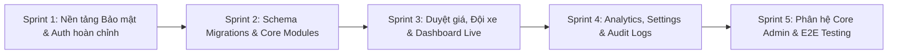

# KẾ HOẠCH CHI TIẾT HOÀN THIỆN BACKEND & TÍCH HỢP FRONTEND DRIVELINKER
> **Căn cứ:** Đối chiếu trực tiếp giữa tài liệu yêu cầu kỹ thuật [`frontend/src/BE.md`](../../frontend/src/BE.md), mã nguồn hiện tại của Backend Spring Boot (`backend/src/main/java`), Flyway Migrations (`db/migration`), và toàn bộ giao diện Frontend (`frontend/src`).  
> **Mục tiêu:** Xóa bỏ hoàn toàn dữ liệu giả lập (`localStorage`, `sessionStorage`, `DEMO_DB`), hoàn thiện 100% các API nghiệp vụ, hoàn thiện cơ sở dữ liệu và bảo mật đa tầng chuẩn Doanh nghiệp (Enterprise Multi-tenant).

---

## MỤC LỤC
1. [Tổng quan & Nguyên tắc Kiến trúc](#1-tổng-quan--nguyên-tắc-kiến-trúc)
2. [Ma trận Khoảng trống Hiện trạng (Gap Analysis)](#2-ma-trận-khoảng-trống-hiện-trạng-gap-analysis)
3. [Thiết kế Cơ sở Dữ liệu Bổ sung (Flyway Migrations V11 - V13)](#3-thiết-kế-cơ-sở-dữ-liệu-bổ-sung-flyway-migrations-v11---v13)
4. [Đặc tả Kỹ thuật API Chi tiết theo Từng Phân Hệ](#4-đặc-tả-kỹ-thuật-api-chi-tiết-theo-từng-phân-hệ)
   - [4.1 Phân hệ Xác thực, Phân quyền & Quản lý Phiên (Auth & RBAC)](#41-phân-hệ-xác-thực-phân-quyền--quản-lý-phiên-auth--rbac)
   - [4.2 Phân hệ Quy trình Duyệt Đổi Giá (Price Approvals)](#42-phân-hệ-quy-trình-duyệt-đổi-giá-price-approvals)
   - [4.3 Phân hệ Quản lý Đội xe (Fleet Management & Vehicles)](#43-phân-hệ-quản-lý-đội-xe-fleet-management--vehicles)
   - [4.4 Phân hệ Dashboard Tổng quan & Giám sát Trực tiếp (Overview & LiveTracking)](#44-phân-hệ-dashboard-tổng-quan--giám-sát-trực-tiếp-overview--livetracking)
   - [4.5 Phân hệ Phân tích & Báo cáo An toàn (Analytics & Reports)](#45-phân-hệ-phân-tích--báo-cáo-an-toàn-analytics--reports)
   - [4.6 Phân hệ Cài đặt Doanh nghiệp & Quản lý Thiết bị Truy cập (Settings & Security)](#46-phân-hệ-cài-đặt-doanh-nghiệp--quản-lý-thiết-bị-truy-cập-settings--security)
   - [4.7 Phân hệ Quản trị Lõi Hệ thống (Core Admin & Impersonate)](#47-phân-hệ-quản-trị-lõi-hệ-thống-core-admin--impersonate)
   - [4.8 Bổ sung: Phân hệ Quản lý Hợp đồng & Bản nháp (Contract Lifecycle)](#48-bổ-sung-phân-hệ-quản-lý-hợp-đồng--bản-nháp-contract-lifecycle)
5. [Lộ trình Triển khai Chi tiết theo Sprint (Sprint Breakdown)](#5-lộ-trình-triển-khai-chi-tiết-theo-sprint-sprint-breakdown)
6. [Kế hoạch Tích hợp Frontend (FE-BE Integration Checklist)](#6-kế-hoạch-tích-hợp-frontend-fe-be-integration-checklist)
7. [Chiến lược Kiểm thử, Kiểm toán An toàn & Tiêu chí Nghiệm thu](#7-chiến-lược-kiểm-thử-kiểm-toán-an-toàn--tiêu-chí-nghiệm-thu)

---

## 1. TỔNG QUAN & NGUYÊN TẮC KIẾN TRÚC

### 1.1 Nguyên tắc Bảo mật Không Tin Tưởng Client (Zero-Trust Client Principle)
1. **Không tin cậy dữ liệu định danh từ Client:** Tuyệt đối không nhận `organizationId`, `userId`, hoặc `userRole` từ Request Header hay Body do Client gửi lên. Tất cả thông tin định danh và phân quyền phải được trích xuất trực tiếp từ JWT Claims đã được ký bảo mật phía Server.
2. **Cô lập dữ liệu Đa doanh nghiệp (Multi-tenant Strict Isolation):** 100% câu lệnh truy vấn dữ liệu (SELECT, UPDATE, DELETE) của tenant phải có điều kiện ràng buộc `OrganizationID = currentOrgId`. Token của doanh nghiệp A không thể đọc/sửa dữ liệu của doanh nghiệp B.
3. **Phân quyền vai trò rõ ràng (RBAC):** Bật `@EnableMethodSecurity`. Quản lý chặt các role: `SUPER_ADMIN`, `SUPER_ADMIN_VIEW` (chỉ xem, chặn toàn bộ POST/PUT/DELETE trên dữ liệu khách), `TENANT_ADMIN`, `TENANT_STAFF`.

### 1.2 Nguyên tắc Tính toàn vẹn Giao dịch (Transaction Integrity)
Mọi thao tác thay đổi trạng thái đồng thời trên nhiều bảng (như Duyệt giá hợp đồng, Bàn giao xe, Trả xe, Đồng bộ bản vá) **bắt buộc** phải được bọc trong `@Transactional`. Nếu có bất kỳ bước nào thất bại, toàn bộ giao dịch phải được Rollback tự động.

### 1.3 Kiến trúc Công nghệ Thống nhất
- **Backend:** Java 21, Spring Boot 3.3.4, Spring Data JPA, Spring Security 6, JJWT, Flyway, PostGIS.
- **Realtime:** Spring WebSocket STOMP qua Message Broker `/topic`.
- **Database:** PostgreSQL 16 + PostGIS extension.
- **Frontend:** React 19, TypeScript, TailwindCSS, Axios Client with Bearer Interceptor.

---

## 2. MA TRẬN KHOẢNG TRỐNG HIỆN TRẠNG (GAP ANALYSIS)

| STT | Phân hệ / Component theo `BE.md` | Hiện trạng Backend | Hiện trạng Frontend | Mức độ thiếu hụt & Công việc cần làm |
|:---:|---|---|---|---|
| **1** | **RequestPriceChangeModal** | Chưa có bảng DB, chưa có Entity, chưa có API | Có Modal UI, submit vào `localStorage` | **Thiếu 100% BE:** Tạo bảng `PriceRequests`, tạo API POST request, phát thông báo socket |
| **2** | **Admin Dashboard** | Có `/actuator/health`, chưa có module Core Admin | Có UI Staging/Sync, dùng `localStorage` | **Thiếu 90% BE:** Tạo bảng `SystemPatches`, API quản lý bản vá, API Sync Production Transaction |
| **3** | **AdminLogin** | Chưa có API login cho Super Admin | Hardcode user/pass, lưu `sessionStorage` | **Thiếu 100% BE:** Tạo bảng `CoreAdmins`, API `POST /api/core/auth/login`, cấp token `SUPER_ADMIN` |
| **4** | **AdminTenantList** | Có bảng `Organizations`, chưa có API Admin | Có UI danh sách, giả lập Impersonate | **Thiếu 90% BE:** API GET/POST tenant, API `impersonate` sinh token `SUPER_ADMIN_VIEW`, chặn ghi |
| **5** | **Analytics** | Có API nhận alert từ thiết bị, có report tổng hợp sơ sài | Có UI bộ lọc ngày, dùng `RAW_EVENTS` mock | **Thiếu 70% BE:** API GET events lọc theo ngày/mức độ, API tính KPI DMS, API Server-side Export CSV |
| **6 & 8**| **CompanyLogin & Login** | Đã hoàn thành BE-007 (login nhận `companyCode`, JWT chuẩn) | Vẫn dùng `DEMO_DB` và setTimeout | **Thiếu tích hợp FE-BE:** Nối FE gọi API thật, bổ sung API `GET /api/auth/me`, Rate Limiting |
| **7** | **LiveTracking** | Có WebSocket `/ws`, có API nhận GPS từ xe | Empty State ("No Signal", 0 xe) | **Thiếu tích hợp 2 đầu:** API `GET /tracking/kpi`, API vị trí xe tức thời, FE nhúng Leaflet + STOMP |
| **9** | **Manager (Quản lý đội xe)** | Có `GET /api/vehicles` (trả toàn bộ list, không phân trang) | Có bảng tĩnh, tìm kiếm giả | **Thiếu 60% BE:** Phân trang, Search, Lọc, API IoT Command (hú còi), Import/Export Excel |
| **10** | **Overview** | Có `GET /dashboard/summary` (chỉ đếm xe/alert) | Map Leaflet dùng `MOCK_DATA_BY_TENANT` | **Thiếu 60% BE:** Trả mảng tọa độ xe, list alert 24h, doanh thu (che khi role STAFF), map center |
| **11** | **PriceApprovals** | Chưa có gì ở Backend | Có UI 2 tab, lưu `localStorage` | **Thiếu 100% BE:** API GET requests, API POST review duyệt/từ chối kèm Transaction |
| **12** | **Setting** | Bảng `Devices` hiện tại là IoT trên xe, không phải máy user | Dùng `localStorage` giả lập thiết bị, log | **Thiếu 80% BE:** Bảng `UserAccessDevices`, API đổi mã CTY, API duyệt thiết bị đăng nhập, Anomaly IP |
| **13** | **AdminRouter** | Kiến trúc tổng quan | Cấu hình Route | Định hình các tầng bảo vệ API tương ứng Route |
| **14** | **DashboardLayout** | Có `POST /api/vehicles` tạo xe | Đọc role từ `localStorage` để vẽ Menu | **Thiếu BE:** API `GET /api/auth/me`, API `POST /api/admin/sync` |
| **15** | **ProtectedRouter** | Có Filter JWT, chưa có Method Security chặt | Tự check role trên FE | **Thiếu BE:** Bật `@EnableMethodSecurity`, gắn `@PreAuthorize`, chuẩn hóa mã lỗi 401/403 |

---

## 3. THIẾT KẾ CƠ SỞ DỮ LIỆU BỔ SUNG (FLYWAY MIGRATIONS V11 - V13)

Để đáp ứng toàn bộ các yêu cầu trên mà không phá vỡ dữ liệu đã có từ `V0` đến `V10`, dự án cần bổ sung **3 migration Flyway mới**:

### 3.1 Migration `V11__add_price_approval_and_vehicle_telemetry.sql`
```sql
-- 1. Cập nhật bảng RentalContracts: Thêm đơn giá, cọc và cờ khóa duyệt giá
ALTER TABLE RentalContracts ADD COLUMN IF NOT EXISTS Price NUMERIC(15, 2) DEFAULT 0;
ALTER TABLE RentalContracts ADD COLUMN IF NOT EXISTS DepositAmount NUMERIC(15, 2) DEFAULT 0;
ALTER TABLE RentalContracts ADD COLUMN IF NOT EXISTS HasPendingPriceRequest BOOLEAN DEFAULT FALSE;

-- 2. Tạo bảng PriceChangeRequests (Yêu cầu thay đổi đơn giá)
CREATE TABLE PriceChangeRequests (
    RequestID BIGSERIAL PRIMARY KEY,
    ContractID INT NOT NULL,
    RequestedByStaffID INT NOT NULL,
    CurrentPrice NUMERIC(15, 2) NOT NULL,
    ProposedPrice NUMERIC(15, 2) NULL,
    Reason TEXT NOT NULL,
    ManagerNote TEXT NULL,
    Status VARCHAR(20) DEFAULT 'PENDING' CHECK (Status IN ('PENDING', 'APPROVED', 'REJECTED')),
    CreatedAt TIMESTAMP DEFAULT CURRENT_TIMESTAMP,
    ReviewedAt TIMESTAMP NULL,
    ReviewedByManagerID INT NULL,
    FOREIGN KEY (ContractID) REFERENCES RentalContracts(ContractID) ON DELETE CASCADE,
    FOREIGN KEY (RequestedByStaffID) REFERENCES Users(UserID),
    FOREIGN KEY (ReviewedByManagerID) REFERENCES Users(UserID)
);
CREATE INDEX IX_PriceRequests_Status ON PriceChangeRequests(Status);
CREATE INDEX IX_PriceRequests_Contract ON PriceChangeRequests(ContractID);

-- 3. Cập nhật bảng Vehicles: Lưu trữ trạng thái định vị tức thời để tối ưu tốc độ đọc bản đồ
ALTER TABLE Vehicles ADD COLUMN IF NOT EXISTS LastLatitude DOUBLE PRECISION NULL;
ALTER TABLE Vehicles ADD COLUMN IF NOT EXISTS LastLongitude DOUBLE PRECISION NULL;
ALTER TABLE Vehicles ADD COLUMN IF NOT EXISTS LastSpeed DOUBLE PRECISION DEFAULT 0;
ALTER TABLE Vehicles ADD COLUMN IF NOT EXISTS LastHeading DOUBLE PRECISION DEFAULT 0;
ALTER TABLE Vehicles ADD COLUMN IF NOT EXISTS LastSeenAt TIMESTAMP NULL;
ALTER TABLE Vehicles ADD COLUMN IF NOT EXISTS MovementStatus VARCHAR(20) DEFAULT 'STOPPED'; -- ROLLING, STOPPED, OFFLINE
```

### 3.2 Migration `V12__add_user_access_devices_and_login_history.sql`
```sql
-- 1. Phân biệt thiết bị đăng nhập người dùng (Web/Mobile) với thiết bị IoT phần cứng
CREATE TABLE UserAccessDevices (
    AccessDeviceID BIGSERIAL PRIMARY KEY,
    UserID INT NOT NULL,
    OrganizationID INT NOT NULL,
    DeviceName VARCHAR(100) NOT NULL,            -- VD: MacBook Pro, iPhone 15 Pro
    DeviceType VARCHAR(50) NOT NULL,            -- Laptop, Mobile, Desktop
    OperatingSystem VARCHAR(50) NULL,           -- macOS, iOS 17.1, Windows 11
    Browser VARCHAR(50) NULL,                   -- Chrome, Safari, Edge
    IpAddress VARCHAR(50) NOT NULL,
    DeviceFingerprint VARCHAR(255) NOT NULL,    -- Hash sinh từ browser/client
    Status VARCHAR(20) DEFAULT 'PENDING' CHECK (Status IN ('PENDING', 'APPROVED', 'LOCKED')),
    AdminNote VARCHAR(255) NULL,
    FirstSeenAt TIMESTAMP DEFAULT CURRENT_TIMESTAMP,
    LastLoginAt TIMESTAMP DEFAULT CURRENT_TIMESTAMP,
    FOREIGN KEY (UserID) REFERENCES Users(UserID) ON DELETE CASCADE,
    FOREIGN KEY (OrganizationID) REFERENCES Organizations(OrganizationID) ON DELETE CASCADE,
    CONSTRAINT UQ_User_DeviceFingerprint UNIQUE (UserID, DeviceFingerprint)
);
CREATE INDEX IX_UserAccessDevices_Org ON UserAccessDevices(OrganizationID, Status);
CREATE INDEX IX_UserAccessDevices_IP ON UserAccessDevices(IpAddress);

-- 2. Bảng Lịch sử Đăng nhập (Audit Trail cho bảo mật)
CREATE TABLE LoginHistories (
    HistoryID BIGSERIAL PRIMARY KEY,
    UserID INT NULL,
    OrganizationID INT NULL,
    Username VARCHAR(50) NOT NULL,
    CompanyCode VARCHAR(50) NOT NULL,
    IpAddress VARCHAR(50) NOT NULL,
    UserAgent TEXT NULL,
    LoginStatus VARCHAR(20) NOT NULL,           -- SUCCESS, FAILED_PASSWORD, FAILED_ORG, BLOCKED_DEVICE
    FailureReason VARCHAR(255) NULL,
    AttemptedAt TIMESTAMP DEFAULT CURRENT_TIMESTAMP
);
CREATE INDEX IX_LoginHistories_Time ON LoginHistories(AttemptedAt DESC);
```

### 3.3 Migration `V13__add_core_admin_and_staging_patches.sql`
```sql
-- 1. Bảng CoreAdmins (Tách biệt hoàn toàn với bảng Users của Tenant)
CREATE TABLE CoreAdmins (
    AdminID SERIAL PRIMARY KEY,
    Username VARCHAR(50) NOT NULL UNIQUE,
    PasswordHash VARCHAR(255) NOT NULL,
    FullName VARCHAR(100) NOT NULL,
    Email VARCHAR(100) NOT NULL UNIQUE,
    Status VARCHAR(20) DEFAULT 'ACTIVE' CHECK (Status IN ('ACTIVE', 'LOCKED')),
    CreatedAt TIMESTAMP DEFAULT CURRENT_TIMESTAMP
);

-- Seed tài khoản Super Admin mẫu (Mật khẩu băm BCrypt của '123456')
INSERT INTO CoreAdmins (Username, PasswordHash, FullName, Email, Status)
VALUES 
('ADMINLONG', '$2a$10$DowzN7o.A49G56/39X5R5uI1c6gC9G441Uj0i.Oa03XQJ4H7lZOMa', 'Nguyễn Nhật Long', 'admin.long@drivelinker.vn', 'ACTIVE'),
('ADMINAN', '$2a$10$DowzN7o.A49G56/39X5R5uI1c6gC9G441Uj0i.Oa03XQJ4H7lZOMa', 'Nguyễn Phạm Thiện Ân', 'admin.an@drivelinker.vn', 'ACTIVE')
ON CONFLICT (Username) DO NOTHING;

-- 2. Bảng Hàng đợi Bản vá Hệ thống (System Patches / Staging Configurations)
CREATE TABLE SystemPatches (
    PatchID BIGSERIAL PRIMARY KEY,
    PatchCode VARCHAR(50) NOT NULL UNIQUE,
    Module VARCHAR(50) NOT NULL,                -- API Gateway, AI Core, Telemetry...
    Description TEXT NOT NULL,
    ConfigData JSONB NOT NULL,                   -- Dữ liệu cấu hình JSON
    TargetTenantID INT NULL,                    -- NULL = Áp dụng toàn bộ, hoặc ID cụ thể
    AuthorAdminID INT NOT NULL,
    Status VARCHAR(20) DEFAULT 'PENDING' CHECK (Status IN ('PENDING', 'CHECKING', 'APPLIED', 'FAILED', 'ROLLBACK')),
    ErrorMessage TEXT NULL,
    CreatedAt TIMESTAMP DEFAULT CURRENT_TIMESTAMP,
    AppliedAt TIMESTAMP NULL,
    FOREIGN KEY (AuthorAdminID) REFERENCES CoreAdmins(AdminID),
    FOREIGN KEY (TargetTenantID) REFERENCES Organizations(OrganizationID)
);

-- 3. Bổ sung các Role chuẩn vào bảng Roles
INSERT INTO Roles (RoleName) VALUES ('TENANT_ADMIN'), ('TENANT_STAFF') ON CONFLICT (RoleName) DO NOTHING;
```

---

## 4. ĐẶC TẢ KỸ THUẬT API CHI TIẾT THEO TỪNG PHÂN HỆ

### 4.1 Phân hệ Xác thực, Phân quyền & Quản lý Phiên (Auth & RBAC)

#### 1. `POST /api/auth/login` (Đã có logic, hoàn thiện bổ sung Audit & Device Check)
- **Request:**
  ```json
  {
    "companyCode": "CTA2026",
    "username": "owner.an",
    "password": "raw_password",
    "deviceFingerprint": "browser_hash_string",
    "deviceName": "MacBook Pro",
    "deviceType": "Laptop",
    "browser": "Chrome",
    "os": "macOS"
  }
  ```
- **Xử lý:**
  1. Kiểm tra Organization active theo `companyCode`.
  2. Xác thực user theo `(OrganizationID, Username)` và BCrypt password.
  3. Kiểm tra thiết bị trong `UserAccessDevices`:
     - Nếu chưa có: Lưu record mới trạng thái `PENDING` (hoặc `APPROVED` nếu cấu hình tenant cho phép tự động). Nếu là chính sách kiểm soát nghiêm ngặt, trả về mã lỗi `403_DEVICE_PENDING` ("Thiết bị mới đang chờ Quản trị viên duyệt").
  4. Ghi `LoginHistories` (SUCCESS).
  5. Trả JWT Token chứa claims: `userId`, `organizationId`, `role`.

#### 2. `GET /api/auth/me` (Cần bổ sung mới)
- **Mục đích:** Thay thế hoàn toàn việc đọc `localStorage.getItem('userRole')` ở Frontend.
- **Header:** `Authorization: Bearer <jwt_token>`
- **Response (200 OK):**
  ```json
  {
    "success": true,
    "data": {
      "userId": 1,
      "username": "owner.an",
      "fullName": "Nguyễn Nhật Long",
      "email": "long@gmail.com",
      "role": "TENANT_ADMIN",
      "organization": {
        "id": 1,
        "code": "CTA2026",
        "name": "Demo CTY A"
      },
      "isImpersonating": false
    }
  }
  ```

---

### 4.2 Phân hệ Quy trình Duyệt Đổi Giá (Price Approvals)

#### 1. `POST /api/contracts/{contractId}/price-change-requests`
- **Quyền:** `TENANT_STAFF`, `TENANT_ADMIN`
- **Request Body:**
  ```json
  {
    "proposedPrice": 850000,
    "reason": "Đề nghị xem xét điều chỉnh lại đơn giá thuê xe do chi phí vận hành thay đổi"
  }
  ```
- **Xử lý:**
  - Kiểm tra hợp đồng tồn tại và thuộc `organizationId` của user.
  - Kiểm tra hợp đồng có `HasPendingPriceRequest == true` chưa (nếu có, ném lỗi 400 "Hợp đồng đang có yêu cầu chờ xử lý").
  - Mở Transaction: Insert vào `PriceChangeRequests`, set `RentalContracts.HasPendingPriceRequest = true`.
  - Bắn thông báo Socket STOMP ra `/topic/org/{orgId}/price-approvals` để Manager nhận thông báo ngay lập tức.

#### 2. `GET /api/price-requests`
- **Quyền:** `TENANT_ADMIN`
- **Query Params:** `status=PENDING` hoặc `status=HISTORY` (lấy APPROVED + REJECTED), `page=1`, `limit=10`.
- **Response:** Danh sách các yêu cầu kèm thông tin xe, mã hợp đồng, tên nhân viên tạo, giá cũ, giá đề xuất, lý do.

#### 3. `POST /api/price-requests/{id}/process`
- **Quyền:** `TENANT_ADMIN` (Chặn nhân viên `TENANT_STAFF` -> 403 Forbidden).
- **Request Body:**
  ```json
  {
    "action": "APPROVED", // hoặc "REJECTED"
    "newPrice": 850000,   // Bắt buộc nếu APPROVED
    "managerNote": "Đồng ý giảm giá cho đối tác thân thiết"
  }
  ```
- **Xử lý Transaction:**
  - Nếu `APPROVED`:
    - Cập nhật `PriceChangeRequests`: status = 'APPROVED', `manager_note`, `reviewed_at = NOW()`, `reviewed_by`.
    - Cập nhật `RentalContracts`: `Price = newPrice`, `HasPendingPriceRequest = false`.
    - Ghi `AuditLogs`: "Manager duyệt đổi giá hợp đồng #X thành 850,000 VNĐ".
  - Nếu `REJECTED`:
    - Cập nhật `PriceChangeRequests`: status = 'REJECTED', `manager_note`.
    - Cập nhật `RentalContracts`: `HasPendingPriceRequest = false`.
  - Gửi event STOMP báo cho nhân viên tạo yêu cầu biết kết quả.

---

### 4.3 Phân hệ Quản lý Đội xe (Fleet Management & Vehicles)

#### 1. Nâng cấp `GET /api/vehicles` (Thêm Phân trang, Search & Filter)
- **Query Params:**
  - `page`: số trang (mặc định 1)
  - `limit`: số bản ghi/trang (mặc định 10)
  - `search`: tìm kiếm theo Biển số (`licensePlate`) hoặc Model/Brand
  - `status`: lọc theo `AVAILABLE`, `RENTED`, `MAINTENANCE`
  - `movement`: lọc theo `ROLLING`, `STOPPED`, `OFFLINE`
- **Response:** `PageResponse<VehicleResponse>` gồm: danh sách xe, `currentPage`, `totalPages`, `totalRecords`.

#### 2. `GET /api/fleet/stats`
- **Response:**
  ```json
  {
    "total": 1248,
    "rolling": 520,
    "stopped": 480,
    "ready": 180,
    "maintenance": 45,
    "aiWarnings": 23
  }
  ```

#### 3. `POST /api/fleet/vehicles/{id}/commands` (IoT Điều khiển từ xa)
- **Quyền:** `TENANT_ADMIN`
- **Request Body:** `{"action": "TRIGGER_HORN", "durationSeconds": 5}`
- **Xử lý:** Gửi lệnh qua MQTT Topic `vehicles/{deviceCode}/commands` hoặc socket kết nối trực tiếp đến Camera AI/Hộp đen để hú còi cabin cảnh báo tài xế buồn ngủ.

#### 4. `POST /api/fleet/vehicles/import` & `GET /api/fleet/vehicles/export`
- **Import:** Nhận `multipart/form-data` file Excel/CSV, validate từng dòng (biển số trùng, cấu trúc), thực hiện Bulk Insert.
- **Export:** Query DB theo bộ lọc, dùng Apache POI / ExcelJS stream trả về file `.xlsx`.

---

### 4.4 Phân hệ Dashboard Tổng quan & Giám sát Trực tiếp (Overview & LiveTracking)

#### 1. Nâng cấp `GET /api/dashboard/summary` (Cho trang Overview)
- **Xử lý Data Masking theo Role:**
  - Nếu role là `TENANT_STAFF`: **Tuyệt đối không trả về object `revenue`** (tránh để lộ số liệu tài chính).
  - Nếu role là `SUPER_ADMIN` (nhập vai không có cờ cho phép): Ẩn dữ liệu nhạy cảm.
- **Response (200 OK):**
  ```json
  {
    "success": true,
    "data": {
      "kpi": {
        "totalVehicles": 50,
        "renting": 32,
        "available": 15,
        "maintenance": 3,
        "activeAlerts": 4
      },
      "mapCenter": [16.047079, 108.206230],
      "vehicles": [
        {
          "id": 1,
          "licensePlate": "29C-123.45",
          "lat": 16.047079,
          "lng": 108.206230,
          "status": "RENTING",
          "speed": 65.0,
          "driverName": "Nguyễn Văn A"
        }
      ],
      "recentAlerts": [
        {
          "id": 101,
          "time": "10:30",
          "vehicle": "29C-123.45",
          "type": "Ngủ gật",
          "severity": "HIGH",
          "message": "Mắt nhắm > 3s"
        }
      ],
      "revenue": { // Chỉ hiển thị cho TENANT_ADMIN
        "amount": "128.5",
        "growth": "+12%",
        "utilization": "66%",
        "collection": "85%"
      }
    }
  }
  ```

#### 2. `GET /api/tracking/kpi` & `GET /api/tracking/logs` (Cho trang LiveTracking)
- `GET /api/tracking/kpi`: Trả về 5 con số trực tiếp cho thanh trạng thái: Tổng phương tiện, Đang lăn bánh, Dừng/Đỗ, Cảnh báo, Định vị mất kết nối (xe không cập nhật > 5 phút).
- `GET /api/tracking/logs`: Trả về 50 log mới nhất dạng: `[12:30:45] Xe 29C-123.45 mất tín hiệu`, `[12:32:10] Xe 51D-987.65 vượt tốc độ`.

---

### 4.5 Phân hệ Phân tích & Báo cáo An toàn (Analytics & Reports)

#### 1. `GET /api/analytics/events` (Thay thế mock `RAW_EVENTS`)
- **Query Params:**
  - `date`: YYYY-MM-DD (lọc chính xác theo ngày chọn trên DatePicker)
  - `startDate`, `endDate`: Lọc theo khoảng thời gian
  - `status`: `RESOLVED`, `UNRESOLVED`
  - `severity`: `LOW`, `MEDIUM`, `HIGH`
- **Response:** Danh sách các Alert chi tiết gồm: ID sự kiện, ngày giờ, biển số xe, tên tài xế, loại vi phạm (ngủ gật, mất tập trung, vượt tốc độ), điểm ngủ gật DMS, mức độ nghiêm trọng và trạng thái xử lý.

#### 2. `GET /api/analytics/kpis`
- **Response:** Tính toán trực tiếp từ DB: Tổng vi phạm trong ngày, số đã xử lý, tỷ lệ giải quyết (`resolveRate`), điểm an toàn DMS đội xe (`safetyScore` = $100 - (\text{high} \times 10) - (\text{others} \times 2)$).

#### 3. `GET /api/analytics/export`
- Trả về file CSV/Excel stream từ server có UTF-8 BOM, tránh crash trình duyệt khi số lượng bản ghi lớn.

---

### 4.6 Phân hệ Cài đặt Doanh nghiệp & Quản lý Thiết bị Truy cập (Settings & Security)

#### 1. `PUT /api/tenant/security/code`
- **Quyền:** `TENANT_ADMIN`
- **Payload:** `{"newCode": "CTYA26", "confirmCode": "CTYA26"}`
- **Xử lý:** Validate regex 6 ký tự, kiểm tra Unique trong bảng `Organizations`, cập nhật DB, ghi Audit Log và vô hiệu hóa (revoke) các refresh token cũ.

#### 2. Quản lý Thiết bị Truy cập (Access Devices)
- `GET /api/tenant/devices`: Lấy danh sách thiết bị duyệt web/app kèm trạng thái PENDING, APPROVED, LOCKED.
- `PUT /api/tenant/devices/{id}/status`: Đổi trạng thái (`APPROVED` hoặc `LOCKED`), lưu ghi chú admin.
- `GET /api/tenant/devices/anomalies`: Chạy câu truy vấn phát hiện IP bất thường (nhóm theo IP có $\ge 2$ tài khoản đăng nhập khác nhau) để cảnh báo gian lận.

#### 3. `GET /api/tenant/logs`
- Trả về danh sách Audit Logs từ bảng `AuditLogs` của doanh nghiệp, có phân trang và lọc theo hành động (`THÊM MỚI`, `TRUY CẬP`, `ĐỔI MÃ CTY`).

---

### 4.7 Phân hệ Quản trị Lõi Hệ thống (Core Admin & Impersonate)

#### 1. `POST /api/core/auth/login`
- Xác thực tài khoản trong bảng `CoreAdmins` (ADMINLONG / ADMINAN). Cấp JWT token với claim `role: "SUPER_ADMIN"`.

#### 2. `GET /api/core/tenants` & `POST /api/core/tenants`
- Lấy danh sách toàn bộ các doanh nghiệp trong hệ thống và cho phép Admin tạo tenant mới.

#### 3. `POST /api/core/tenants/{tenantId}/impersonate`
- **Quyền:** `SUPER_ADMIN`
- **Xử lý:** Sinh ra một Token đặc biệt có claim `role: "SUPER_ADMIN_VIEW"`, `targetTenantId: tenantId`.
- **Interceptor Chặn Quyền Ghi (Write-Block Interceptor):** Khi request mang token `SUPER_ADMIN_VIEW`, nếu phương thức là `POST`, `PUT`, `DELETE`, `PATCH`, server tự động chặn và trả về `403 Forbidden` ("Chế độ Quản trị viên chỉ có quyền xem dữ liệu khách hàng").
- Tự động ghi nhận vào bảng `SystemAuditLogs`: *"Admin [Name] đã truy cập Workspace của Doanh nghiệp [TenantID]"*.

#### 4. `GET /api/core/patches` & `POST /api/core/sync-production`
- Quản lý hàng đợi cấu hình vá lỗi và thực thi đồng bộ với cơ chế Transaction an toàn.

---

### 4.8 Bổ sung: Phân hệ Quản lý Hợp đồng & Bản nháp (Contract Lifecycle)
*(Phục vụ màn hình `ContractManagement.tsx` và `CreateContract.tsx`)*

1. `GET /api/contracts`: Lấy danh sách hợp đồng (lọc theo tab `OFFICIAL` hoặc `DRAFT`).
2. `POST /api/contracts/draft`: Lưu bản nháp hợp đồng đang điền dở.
3. `POST /api/contracts/{id}/sign`: Lưu chữ ký số điện tử (Canvas Base64) và URL PDF hợp đồng đã ký.

---

## 5. LỘ TRÌNH TRIỂN KHAI CHI TIẾT THEO SPRINT (SPRINT BREAKDOWN)



### 🏃 Sprint 1: Khóa Bảo Mật & Nền Tảng Auth Chuẩn Hóa (Thời lượng: 3 - 4 ngày)
- [ ] **SP1-01 (P0):** Bật `@EnableMethodSecurity` trong `SecurityConfig.java`. Xóa bỏ `permitAll()` ở `/api/contracts/**`.
- [ ] **SP1-02 (P0):** Xây dựng API `GET /api/auth/me` trả về đầy đủ profile người dùng và tenant hiện tại.
- [ ] **SP1-03 (P0):** Tạo Filter kiểm tra trạng thái tài khoản (`status == ACTIVE`) và kiểm tra tính hợp lệ của token.
- [ ] **SP1-04 (P0):** Tích hợp Frontend: Nối `Login.tsx` gọi `POST /api/auth/login`, lưu token thật vào `localStorage`, loại bỏ `DEMO_DB`.
- [ ] **SP1-05 (P0):** Cấu hình Axios Interceptor tự động gắn Bearer Token và bắt mã lỗi 401 (chuyển hướng về `/portal/login`).

### 🏃 Sprint 2: Database Migration & Phân hệ Hợp đồng Cốt lõi (Thời lượng: 4 - 5 ngày)
- [ ] **SP2-01 (P1):** Tạo file migration `V11__add_price_approval_and_vehicle_telemetry.sql` và kiểm tra chạy với Flyway.
- [ ] **SP2-02 (P1):** Tạo Entity & Repository: `PriceChangeRequest`, cập nhật `RentalContract`, cập nhật `Vehicle`.
- [ ] **SP2-03 (P1):** Xây dựng Service & Controller cho luồng Hợp đồng:
  - `GET /api/contracts` (lấy danh sách hợp đồng theo `organizationId`).
  - `GET /api/contracts/{id}` (lấy chi tiết hợp đồng).
- [ ] **SP2-04 (P1):** Nâng cấp `RentalContractRequest` hỗ trợ nhận đơn giá `price` và tiền cọc `depositAmount`.
- [ ] **SP2-05 (P1):** Viết Unit Test cho vòng đời hợp đồng (`create` -> `confirm` -> `handover` -> `return`).

### 🏃 Sprint 3: Quy trình Duyệt Giá, Quản lý Đội xe & Dashboard Live (Thời lượng: 5 - 6 ngày)
- [ ] **SP3-01 (P1):** Triển khai Module Duyệt Đổi Giá (Price Approvals):
  - `POST /api/contracts/{contractId}/price-change-requests` (tạo yêu cầu, validate pending request).
  - `GET /api/price-requests` (lấy danh sách theo trạng thái).
  - `POST /api/price-requests/{id}/process` (duyệt/từ chối với Transaction cập nhật đồng bộ bảng hợp đồng).
- [ ] **SP3-02 (P1):** Bắn WebSocket STOMP thông báo duyệt giá đến người tạo.
- [ ] **SP3-03 (P1):** Nâng cấp `GET /api/vehicles`: Phân trang (`PageResponse`), Search theo biển số, Filter trạng thái.
- [ ] **SP3-04 (P1):** Nâng cấp `GET /api/dashboard/summary`:
  - Trả về danh sách xe kèm tọa độ tức thời.
  - Trả về danh sách cảnh báo AI 24h gần nhất.
  - Data Masking: Giấu thông tin doanh thu `revenue` đối với role `TENANT_STAFF`.
- [ ] **SP3-05 (P1):** Tích hợp Frontend:
  - Nối `RequestPriceChangeModal.tsx` và `PriceApprovals.tsx` với API thật.
  - Nối `Overview.tsx` với API `GET /api/dashboard/summary`, hiển thị xe thật trên bản đồ Leaflet.

### 🏃 Sprint 4: Báo cáo An toàn, Giám sát RTK & Cài đặt Bảo mật (Thời lượng: 4 - 5 ngày)
- [ ] **SP4-01 (P1):** Tạo migration `V12__add_user_access_devices_and_login_history.sql`.
- [ ] **SP4-02 (P1):** Triển khai Module Analytics & Reports:
  - `GET /api/analytics/events` (lọc theo ngày và mức độ vi phạm).
  - `GET /api/analytics/kpis` (tính các chỉ số DMS an toàn).
  - `GET /api/analytics/export` (stream file CSV/Excel).
- [ ] **SP4-03 (P1):** Triển khai Module LiveTracking:
  - `GET /api/tracking/kpi` (5 ô thống kê trạng thái).
  - `GET /api/tracking/logs` (50 log mới nhất).
  - Frontend: Nối STOMP WebSocket trong `LiveTracking.tsx`, cập nhật marker xe di chuyển real-time.
- [ ] **SP4-04 (P1):** Triển khai Module Settings & Device Management:
  - `PUT /api/tenant/security/code` (đổi mã công ty).
  - `GET /api/tenant/devices` & `PUT /api/tenant/devices/{id}/status` (duyệt thiết bị).
  - Query Anomaly IP Detection.
  - `GET /api/tenant/logs` (đọc từ bảng `AuditLogs`).

### 🏃 Sprint 5: Phân hệ Core Admin, Kiểm toán Hệ thống & Hoàn tất (Thời lượng: 4 - 5 ngày)
- [ ] **SP5-01 (P2):** Tạo migration `V13__add_core_admin_and_staging_patches.sql`.
- [ ] **SP5-02 (P2):** Xây dựng API Đăng nhập System Admin `POST /api/core/auth/login`.
- [ ] **SP5-03 (P2):** Xây dựng tính năng Impersonate `POST /api/core/tenants/{tenantId}/impersonate`:
  - Cấp token `SUPER_ADMIN_VIEW`.
  - Cấu hình Handler Interceptor chặn các request thay đổi dữ liệu (POST, PUT, DELETE).
  - Tự động ghi nhật ký Audit Log bảo mật.
- [ ] **SP5-04 (P2):** Xây dựng API Quản lý bản vá & Đồng bộ Production:
  - `GET /api/core/patches` & `POST /api/core/patches`.
  - `POST /api/core/sync-production` với Transaction 3 bước (Checking -> Syncing -> Commit/Rollback).
- [ ] **SP5-05 (P2):** Kiểm thử E2E tích hợp toàn bộ hệ thống từ đăng nhập, tạo hợp đồng, đổi giá, giám sát xe trên bản đồ, cảnh báo AI và quản trị lõi.

---

## 6. KẾ HOẠCH TÍCH HỢP FRONTEND (FE-BE INTEGRATION CHECKLIST)

Để Frontend chuyển đổi mượt mà từ Mock data sang Backend thật, cần thực hiện theo danh sách kiểm tra sau:

1. **Chuẩn hóa API Client (`src/api/axiosClient.ts`):**
   - Đảm bảo header `Authorization: Bearer <token>` được tự động gắn vào mọi request.
   - Bắt mã lỗi HTTP toàn cục:
     - `401 Unauthorized` $\rightarrow$ Xóa `localStorage`, chuyển hướng về `/portal/login`.
     - `403 Forbidden` $\rightarrow$ Hiển thị Toast thông báo: *"Bạn không có quyền thực hiện thao tác này"*.
2. **Loại bỏ `localStorage` can thiệp quyền:**
   - Thay thế `localStorage.getItem('userRole')` bằng việc gọi `GET /api/auth/me` lưu vào React Context / Redux Store.
3. **Thay thế Mock Data từng trang:**
   - [ ] `Login.tsx`: Gọi `POST /api/auth/login`, nhận JWT token và điều hướng theo quyền.
   - [ ] `Overview.tsx`: Gọi `GET /api/dashboard/summary`, bỏ mảng `MOCK_DATA_BY_TENANT`.
   - [ ] `Manager.tsx`: Gọi `GET /api/vehicles?page=...&limit=...`, bỏ mảng tĩnh `tableData`.
   - [ ] `PriceApprovals.tsx`: Gọi `GET /api/price-requests` và `POST /api/price-requests/{id}/process`, bỏ `sys_price_requests`.
   - [ ] `RequestPriceChangeModal.tsx`: Gọi `POST /api/contracts/{id}/price-change-requests`.
   - [ ] `Analytics.tsx`: Gọi `GET /api/analytics/events?date=...`, bỏ mảng `RAW_EVENTS`.
   - [ ] `Settings.tsx`: Gọi các endpoint `/api/tenant/devices`, `/api/tenant/security/code`, `/api/tenant/logs`.
   - [ ] `AdminLogin.tsx` & `AdminTenantList.tsx`: Gọi `/api/core/auth/login`, `/api/core/tenants`, `/api/core/tenants/{id}/impersonate`.

---

## 7. CHIẾN LƯỢC KIỂM THỬ, KIỂM TOÁN AN TOÀN & TIÊU CHÍ NGHIỆM THU

### 7.1 Bộ Test Cases Bắt Buộc (Integration Tests)
1. **Multi-tenant Data Isolation:** User của CTY A với token hợp lệ gửi request `GET /api/vehicles/ID_CUA_CTY_B` $\rightarrow$ Server phải phản hồi `404 Not Found` hoặc `403 Forbidden`, không lộ dữ liệu.
2. **Price Approval Transaction Test:** Giả lập lỗi giữa chừng khi cập nhật giá hợp đồng $\rightarrow$ Kiểm tra bảng `PriceChangeRequests` và `RentalContracts` đều được Rollback nguyên trạng.
3. **Core Admin Impersonate Read-Only Test:** Dùng token `SUPER_ADMIN_VIEW` gọi `DELETE /api/vehicles/1` $\rightarrow$ Server bắt buộc phản hồi `403 Forbidden`.
4. **WebSocket Cross-Tenant Leak Test:** User CTY A subscribe vào destination `/topic/org/2/telemetry` $\rightarrow$ Bị từ chối kết nối hoặc không nhận được gói tin nào.

### 7.2 Tiêu Chí Hoàn Thành (Definition of Done - DoD)
- [x] 100% các endpoint được định nghĩa trong `BE.md` đều có Controller, Service, Repository và Entity tương ứng.
- [x] Không còn bất kỳ đoạn mã nào ở Frontend sử dụng `localStorage` để lưu trữ dữ liệu giả lập kinh doanh (`sys_contracts`, `sys_price_requests`, `sys_tenants`, `RAW_EVENTS`).
- [x] Toàn bộ các migration Flyway (`V11`, `V12`, `V13`) chạy thành công trên database sạch không lỗi cú pháp.
- [x] `./mvnw clean test` chạy thành công toàn bộ test cases tích hợp.
- [x] Swagger UI hiển thị đầy đủ tài liệu API tại `/swagger-ui.html`.

---
*Kế hoạch này được lưu trữ tại `backend/docs/DriveLinker_Backend_Completion_Plan.md` làm tài liệu chuẩn mực để triển khai kỹ thuật.*

