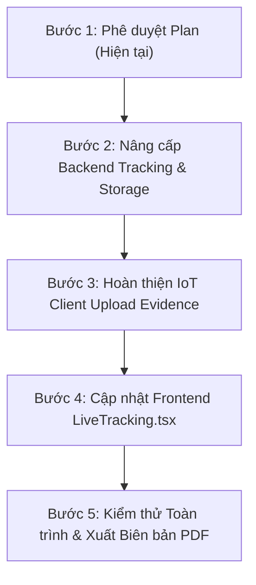

# BẢN THIẾT KẾ HOÀN CHỈNH & KẾ HOẠCH TRIỂN KHAI PHÂN HỆ GIÁM SÁT HÀNH TRÌNH (TRACKING MẪU 1A)
> **Dự án:** DriveLinker - Hệ thống Giám sát & Quản trị Xe Cho Thuê Thông Minh  
> **Phiên bản:** Mẫu 1A (Fleet Command Pro - Phiên bản Đội xe Đang thuê & Bằng chứng Đa ngày)  
> **Trạng thái:** Đã chốt thiết kế (Chờ lệnh người dùng phê duyệt trước khi code)  
> **Tài liệu tham chiếu:** `backend-next/docs/lichsu.md`, `prisma/schema.prisma`

---

## 📌 1. TỔNG QUAN & NGUYÊN TẮC THIẾT KẾ CỐT LÕI

Dựa trên yêu cầu nghiệp vụ thực tế của chủ doanh nghiệp cho thuê xe, phân hệ Giám sát Hành trình được chuẩn hóa theo 2 nguyên tắc vàng:

### 1.1. Nguyên tắc 1: Chỉ theo dõi những xe ĐÃ CÓ HỢP ĐỒNG CHO THUÊ (Hợp đồng ACTIVE)
- **Lý do nghiệp vụ:** Doanh nghiệp có thể sở hữu 50 phương tiện, nhưng tại một thời điểm chỉ có khoảng 10 - 15 xe đang bàn giao cho khách lưu thông ngoài đường. 
- **Quy tắc hệ thống:**
  - **Xe hiển thị trên màn hình `/tracking`:** CHỈ bao gồm các phương tiện đang gắn liền với một `RentalContract` có trạng thái `status = 'ACTIVE'` và phiên giám sát `MonitoringSession` đang mở (`status = 'ACTIVE'`).
  - **Xe tự động ẩn:** Toàn bộ xe chưa có khách thuê (trạng thái kho `AVAILABLE`), xe bảo dưỡng (`MAINTENANCE`) hoặc xe đã thanh lý hợp đồng (`COMPLETED`) sẽ **tuyệt đối không xuất hiện** trên màn hình này.
  - **Lợi ích:** Tránh làm loãng giao diện điều hành, bảo vệ quyền riêng tư nội bộ của nhân viên kỹ thuật và tối ưu băng thông máy chủ.

### 1.2. Nguyên tắc 2: Quản lý Bằng chứng Vi phạm khi Xe thuê nhiều ngày (Không giới hạn 6 ảnh)
- **Lý do nghiệp vụ:** Một hợp đồng thuê xe thường kéo dài từ 2 đến 7 ngày (hoặc cả tháng). Trong suốt hành trình, tài xế có thể vi phạm rải rác: ngày 1 vi phạm 4 lần, ngày 2 vi phạm 6 lần, ngày 3 vi phạm 4 lần... Con số 6 ảnh tĩnh ở mockup trước đó là không đủ.
- **Quy tắc hệ thống:**
  - **Bộ lọc theo Ngày trong Chu kỳ Hợp đồng:** Cho phép người quản lý lọc xem: *Tất cả các ngày thuê*, hoặc xem chi tiết từng ngày cụ thể (`Ngày 1: 01/11`, `Ngày 2: 02/11`, `Hôm nay: 03/11`).
  - **Phân trang (Pagination) & Chế độ Lưới (Grid View):** Hỗ trợ dải ảnh cuộn (Filmstrip) có nút `◀` `▶` chuyển trang (6 - 10 ảnh/trang) và nút chuyển nhanh sang chế độ lưới xem toàn bộ ảnh vi phạm dạng album.
  - **Ảnh bằng chứng chất lượng cao kèm Watermark thông số:** Mỗi ảnh chụp vi phạm phải in trực tiếp thông số GPS, thời gian thực (ngày giờ), vận tốc km/h và độ tin cậy AI (%).
  - **Xuất Biên bản Đối soát Vi phạm (PDF/Report):** Khi khách hàng hoàn trả xe, người quản lý bấm nút **"Xuất biên bản vi phạm"** để tạo hồ sơ tổng hợp toàn bộ hình ảnh bằng chứng làm căn cứ đối soát trừ tiền cọc minh bạch.

---

## 🏗️ 2. KIẾN TRÚC DỮ LIỆU & LƯU TRỮ (STORAGE & DATABASE DESIGN)
*Đảm bảo 100% đồng bộ, không phá vỡ (non-breaking) cơ sở dữ liệu PostgreSQL và Prisma schema hiện tại.*

### 2.1. Cấu trúc Cây Thư mục Lưu trữ Ảnh Bằng chứng (Storage Architecture)
Ảnh vi phạm được nén định dạng JPEG (chất lượng 85%, dung lượng trung bình 80KB - 120KB/ảnh). Cấu trúc phân cấp theo doanh nghiệp, hợp đồng và ngày thuê:

```text
storage/evidence/
  └── {organizationId}/
      └── contracts/
          └── {contractId}/
              ├── 2026-11-01/
              │   ├── EVT-ALT-1730600123-a1b2c3.jpg
              │   └── EVT-ALT-1730604567-d4e5f6.jpg
              ├── 2026-11-02/
              │   └── EVT-ALT-1730689123-g7h8i9.jpg
              └── 2026-11-03/
                  └── EVT-ALT-1730756789-j1k2l3.jpg
```
* **Khả năng mở rộng:** Một hợp đồng phát sinh 100 ảnh vi phạm chỉ chiếm khoảng **8MB - 10MB** dung lượng đĩa. Toàn bộ ảnh được lưu trữ an toàn, dễ dàng sao lưu (backup) hoặc nén ZIP khi thanh lý hợp đồng.

### 2.2. Ánh xạ Cơ sở dữ liệu (Prisma Schema Integration)
Bảng `alerts` trong cơ sở dữ liệu hiện tại đã có cấu trúc:
- `alertid` (BigInt, PK)
- `eventid` (VarChar, Unique)
- `organizationid` (Int, FK -> Organization)
- `vehicleid` (Int, FK -> Vehicle)
- `monitoringsessionid` (BigInt, FK -> MonitoringSession -> RentalContract)
- `alerttype` (VarChar): `DROWSINESS`, `YAWN`, `DISTRACTION`, `HEAD_DROP`
- `severitylevel` (VarChar): `WARNING`, `DANGER`, `CRITICAL`
- `drowsinessscore` (Int)
- `latitude`, `longitude` (Float)
- `occurredat` (DateTime)
- `resolutionstatus` (VarChar): `NEW`, `RESOLVED`

**Giải pháp mở rộng không gây xung đột (Zero Break):**
- Tận dụng trường `resolutionnote` hoặc bổ sung trường an toàn `evidenceUrl: String?` (đường dẫn tương đối tới file ảnh: `/api/evidence/contracts/{contractId}/{date}/{fileName}`).
- Dữ liệu truy vấn luôn được liên kết trực tiếp qua `monitoringSession.contractId`, đảm bảo bằng chứng thuộc về đúng đợt thuê của khách hàng đó.

---

## 🔌 3. THIẾT KẾ HỆ THỐNG API BACKEND (NEXT.JS APP ROUTER)

Tất cả các API được thiết kế tuân thủ kiến trúc chuẩn của DriveLinker: `Route Handler` ➔ `Controller` ➔ `Service` ➔ `Prisma ORM` ➔ `ApiResponse`.

### 3.1. API Giám sát Hành trình Đang thuê:
1. `GET /api/tracking/kpi`
   - **Xác thực:** Bearer JWT (Tenant Admin / Manager).
   - **Nghiệp vụ:** Chỉ tính toán chỉ số cho các xe **có hợp đồng đang thuê** (`status = 'ACTIVE'`).
   - **Dữ liệu trả về:**
     ```json
     {
       "success": true,
       "data": {
         "totalVehicles": 4,       // 4 xe đang cho khách thuê (không tính xe nằm bãi)
         "rollingCount": 3,        // 3 xe đang di chuyển
         "stoppedCount": 1,        // 1 xe đang tạm dừng nghỉ chân
         "offlineCount": 0,
         "activeAlertsCount": 14   // Tổng cảnh báo phát sinh từ các xe đang thuê
       }
     }
     ```

2. `GET /api/tracking/positions`
   - **Xác thực:** Bearer JWT.
   - **Nghiệp vụ:** Trả về danh sách xe có hợp đồng thuê `ACTIVE`, kèm tọa độ GPS mới nhất, thông tin khách thuê (`fullName`, `phone`), mã hợp đồng và thời hạn thuê.

### 3.2. API Quản lý Bằng chứng Đa ngày:
3. `GET /api/tracking/contracts/[contractId]/evidence`
   - **Query Parameters:**
     - `date`: `YYYY-MM-DD` (tùy chọn, lọc theo ngày cụ thể; nếu để trống trả về toàn bộ ngày thuê).
     - `alertType`: `ALL` | `DROWSINESS` | `YAWN` | `DISTRACTION` (tùy chọn).
     - `page`: Số trang (mặc định: 1).
     - `limit`: Số ảnh mỗi trang (mặc định: 12).
   - **Dữ liệu trả về:**
     ```json
     {
       "success": true,
       "data": {
         "contract": {
           "id": 101,
           "contractCode": "HĐ-101",
           "customerName": "Trần Văn Khách",
           "phone": "0901.112.233",
           "startTime": "2026-11-01T08:00:00Z",
           "endTime": "2026-11-04T18:00:00Z",
           "totalDays": 3
         },
         "summary": {
           "totalEvidence": 14,
           "byDate": {
             "2026-11-01": 4,
             "2026-11-02": 6,
             "2026-11-03": 4
           }
         },
         "items": [
           {
             "alertId": "1001",
             "eventId": "EVT-ALT-1730756712-a1b2c3",
             "alertType": "DROWSINESS",
             "severityLevel": "CRITICAL",
             "drowsinessScore": 92,
             "occurredAt": "2026-11-03T16:45:12Z",
             "latitude": 16.0610,
             "longitude": 108.2170,
             "speed": 48.5,
             "evidenceUrl": "/uploads/evidence/1/contracts/101/2026-11-03/EVT-ALT-1730756712.jpg"
           }
         ],
         "pagination": { "page": 1, "limit": 12, "totalPages": 2 }
       }
     }
     ```

4. `POST /api/iot/evidence` (Tiếp nhận ảnh từ thiết bị IoT trên xe)
   - **Xác thực:** Header `X-Device-Code` + `X-Device-Secret`.
   - **Payload:** `multipart/form-data` gồm:
     - `image`: File ảnh nhị phân JPEG.
     - `eventId`: Mã sự kiện vi phạm tương ứng với bản tin alert.
     - `contractId`: Mã hợp đồng hiện tại của xe.
   - **Xử lý:** Lưu file vào cây thư mục và cập nhật đường dẫn vào bản ghi `Alert`.

5. `GET /api/tracking/contracts/[contractId]/export-dossier`
   - **Chức năng:** Kết xuất file PDF biên bản đối soát vi phạm đầy đủ danh sách ảnh, giờ, tọa độ GPS và bảng tổng kết vi phạm để chủ xe in hoặc gửi email cho khách thuê khi làm thủ tục trả xe.

---

## 🤖 4. CẦU NỐI IOT TELEMATICS CLIENT (`test_yolo/iot_client.py`)

Trong file `d:\Capstone1\test_yolo\iot_client.py` đã tạo:
- Đã có kiến trúc `Queue` đa luồng non-blocking đảm bảo OpenCV / MediaPipe chạy mượt 30 FPS.
- **Bổ sung tính năng chụp ảnh bằng chứng vi phạm:**
  - Khi `FatigueManager` kích hoạt cảnh báo nguy cấp (ví dụ: `DROWSINESS` mắt nhắm > 1.5s):
    1. Chụp ngay frame ảnh hiện tại từ Camera (`cv2.imencode`).
    2. Ghi watermark thông số kỹ thuật (Tốc độ km/h, Tọa độ GPS, Thời gian thực).
    3. Đẩy tác vụ upload ảnh ngầm vào `iot_client.queue` để gửi lên `/api/iot/evidence`.
    4. Cơ chế chống spam (Cooldown 5.0 giây) tránh chụp hàng loạt ảnh trùng lặp gây quá tải.

---

## 🎨 5. THIẾT KẾ GIAO DIỆN FRONTEND (`LiveTracking.tsx` MẪU 1A)
*(Kế hoạch thay thế component khung hiện tại khi người dùng duyệt "oke")*

```text
+--------------------------------------------------------------------------------------------------------+
| MENU > THEO DÕI | Giám sát Hành trình Xe Đang Cho Thuê                   [🟢 Kết nối RTK Online]       |
+--------------------------------------------------------------------------------------------------------+
| TỔNG XE ĐANG THUÊ: 4  |  ĐANG LĂN BÁNH: 3  |  TẠM DỪNG: 1  |  NGOẠI TUYẾN: 0  |  CẢNH BÁO MỚI: 14      |
+--------------------------------------------------------------------------------------------------------+
| THANH CHỌN XE ĐANG THUÊ (FLEET SELECTOR - CHỈ HIỂN THỊ XE CÓ HỢP ĐỒNG ACTIVE):                         |
| [🚗 43A-999.88 (Đang chọn)]     [🚗 43C-678.90]             [🚗 92A-345.67]            [🚗 43B-888.99] |
| HĐ-101 • Thuê 3 ngày            HĐ-102 • Thuê 5 ngày        HĐ-103 • Thuê 2 ngày       HĐ-104 • 7 ngày |
| Khách: Trần Văn Khách           Khách: Lê Hoàng Nam         Khách: Hoàng Minh Trí      Cty Du Lịch     |
| 48.5 km/h • 14 vi phạm          55.0 km/h • 6 vi phạm       0 km/h (Đỗ) • 2 vi phạm    62 km/h • 8 lỗi |
+-------------------------------------------------------------+------------------------------------------+
| KHU VỰC BẢN ĐỒ GỌN GÀNG (60% WIDTH)                         | KHO BẰNG CHỨNG VI PHẠM ĐA NGÀY (40%)     |
| +---------------------------------------------------------+ | +--------------------------------------+ |
| | [📍 43A-999.88 | 48.5 km/h]           [HĐ-101 Đang thuê]| | | 📸 BẰNG CHỨNG VI PHẠM (14 ảnh / 3 ngày)| |
| |                                                         | | | [Tất cả (14)] [01/11] [02/11] [Hôm nay]| |
| |              CỤM NÚT ZOOM BẢN ĐỒ:                       | | | Lọc: [Tất cả] [Ngủ gật] [Ngáp] [Gục] | |
| |              [ + ]  (Phóng to chi tiết)                 | | +--------------------------------------+ |
| |              [ - ]  (Thu nhỏ bao quát)                  | | | ẢNH LỚN ĐANG XEM CHI TIẾT            | |
| |              [ 🎯 ] (Reset vừa khung xe)                | | | [ 😴 NGỦ GẬT (1.8s) ]                | |
| |              [14x]  (Mức độ zoom)                       | | | Watermark: GPS, 48.5 km/h, 16:45:12  | |
| |                                                         | | | Độ tin cậy AI: 92%                   | |
| | - Ghim vị trí xe thời gian thực                         | | +--------------------------------------+ |
| | - Các ghim 📸 đánh dấu điểm vi phạm trên đường đi       | | | DẢI ẢNH (FILMSTRIP) & PHÂN TRANG:    | |
| |                                                         | | | [◀ 1/3 ▶] [🔲 Chế độ Lưới (Grid)]   | |
| | [HUD: Cầu Rồng, Đà Nẵng • Hướng ĐB 92° • Xăng: 78%]     | | | [Ảnh 1] [Ảnh 2] [Ảnh 3] [Ảnh 4]...   | |
| +---------------------------------------------------------+ | +--------------------------------------+ |
|                                                             | THÔNG TIN HỢP ĐỒNG & ĐỐI SOÁT:           |
|                                                             | - Khách thuê: Trần Văn Khách             |
|                                                             | - Thời hạn thuê: 01/11 -> 04/11/2026     |
|                                                             | - Tổng vi phạm: 14 lần (5 Ngủ gật)       |
|                                                             | [ 📄 XUẤT BIÊN BẢN VI PHẠM (PDF) ]       |
|                                                             | [ 📢 Phát loa cảnh báo tài xế ]          |
+-------------------------------------------------------------+------------------------------------------+
```

---

## 📅 6. LỘ TRÌNH TRIỂN KHAI TỪNG BƯỚC (STEP-BY-STEP PLAN)



### Bước 1: Người dùng đánh giá & Phê duyệt Kế hoạch (Hiện tại)
- Đảm bảo thiết kế giải quyết trọn vẹn bài toán:
  1. Chỉ theo dõi xe có hợp đồng cho khách thuê.
  2. Lưu trữ và hiển thị không giới hạn ảnh khi thuê xe nhiều ngày.
  3. Không can thiệp code vào dự án cho đến khi nhận được lệnh `"oke"`.

### Bước 2: Nâng cấp Backend Tracking & Storage API
- Cập nhật `TrackingService.ts`: Thắt chặt điều kiện lọc xe theo hợp đồng `ACTIVE`.
- Tạo Route `GET /api/tracking/contracts/[contractId]/evidence` (lọc theo ngày, phân trang).
- Tạo Route `POST /api/iot/evidence` (lưu trữ ảnh JPEG vào cây thư mục hợp đồng).
- Tạo Route `GET /api/tracking/contracts/[contractId]/export-dossier` (tạo file đối soát).

### Bước 3: Tích hợp Client IoT Python (`iot_client.py`)
- Kích hoạt logic lưu ảnh frame chụp khi có cảnh báo vi phạm.
- Tự động đính kèm watermark GPS/Tốc độ và gửi lên API Backend.

### Bước 4: Triển khai Giao diện Frontend (`LiveTracking.tsx`)
- Thay thế Empty State bằng bố cục Mẫu 1A:
  - Bản đồ Leaflet tương tác thực tế kèm cụm nút Zoom.
  - Thanh Fleet Selector chỉ hiển thị xe đang thuê.
  - Thư viện ảnh đa ngày với Tab chọn ngày, phân trang, chế độ lưới và preview to.
  - Nút bấm xuất biên bản PDF đối soát.

### Bước 5: Kiểm thử Đồng bộ Toàn diện & Xác nhận
- Bật đồng thời Backend Next.js (`npm run dev`) và IoT Client Python.
- Kiểm tra các số liệu KPI, bản đồ nhảy vị trí xe, thư viện ảnh load mượt mà qua nhiều ngày thuê.
- Ghi nhận lịch sử vào `backend-next/docs/lichsu.md`.

