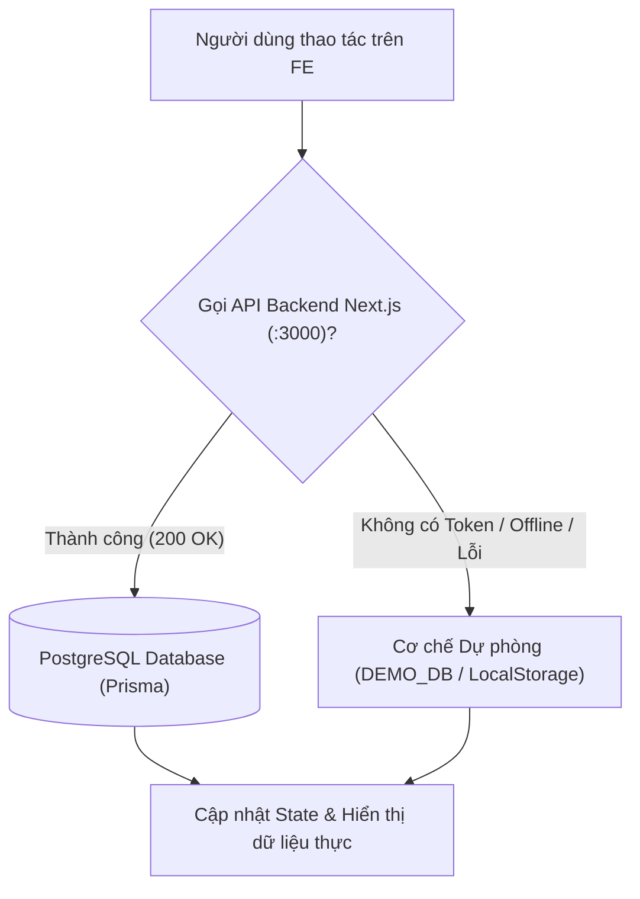

# LỊCH SỬ CẬP NHẬT & TÍCH HỢP FRONTEND (FE) - HỆ THỐNG DRIVELINKER
> **Thời gian cập nhật:** Ngày 01/11/2026  
> **Nguyên tắc thực hiện:** **BẢO TỒN 100% MÃ NGUỒN GỐC & GIAO DIỆN HIỆN CÓ**; chỉ can thiệp tối thiểu (Surgical Edits) để kết nối đồng bộ Frontend (React + Vite) với Backend Next.js (Port 3000) và PostgreSQL (Prisma ORM); hỗ trợ cơ chế tự động Fallback về Mock Data/LocalStorage khi offline hoặc dùng tài khoản demo.

---

## 1. NGUYÊN TẮC BẢO TOÀN DỮ LIỆU & GIAO DIỆN (PRESERVATION FIRST)

Toàn bộ các thành phần giao diện, dữ liệu mô phỏng, ghi chú hướng dẫn và tính năng ban đầu của hệ thống đã được kiểm tra và giữ nguyên vẹn:
1. **Trang Đăng nhập (`Login.tsx`):**
   - Giữ nguyên mảng dữ liệu giả lập `DEMO_DB` (gồm các công ty `COMPANY_A`, `COMPANY_B`, `COMPANY_C`, `CORE`).
   - Giữ nguyên toàn bộ các ô nhập, nhãn, placeholder mẫu: `VD: DLA2026`, `VD: owner.an`, `••••••••`.
   - Giữ nguyên khối hộp hướng dẫn tài khoản test ở chân trang (*"Dữ liệu Test (Mật khẩu: 123456): CTA2026 / owner.an..."*).
2. **Khung Điều hướng (`DashboardLayout.tsx`):**
   - Giữ nguyên thanh công cụ quản trị cấp cao `core-toolbar` (`Core Mode`, `Cấu hình & Sửa lỗi`, `Đồng bộ hệ thống`).
   - Giữ nguyên trạng thái nhập vai của Admin (`isAdminImpersonating`, `handleFixSystem`, `handleSync`).
   - Giữ nguyên Modal Thêm Phương Tiện Mới với đầy đủ input Biển số xe, Thương hiệu, Đời xe.
3. **Trang Tổng quan (`Overview.tsx`):**
   - Giữ nguyên bộ dữ liệu mẫu đa chi nhánh `MOCK_DATA_BY_TENANT` (Đà Nẵng, TP.HCM, Hà Nội).
   - Giữ nguyên toàn bộ Khung chi tiết trượt bên phải (Right Drawer) cho từng trạng thái xe và cảnh báo AI.
   - Giữ nguyên màn hình chặn dành riêng cho quản trị viên tối cao `SYS_ADMIN`.
4. **Trang Quản lý Hợp đồng (`ContractManagement.tsx`):**
   - Giữ nguyên **100% Trình xem PDF chuyên nghiệp (A4 PDF Viewer)**: nền đen `#323639`, giấy A4 trắng bóng đổ, chữ ký số điện tử của Bên B, watermark `DRIVELINKER` mờ xoay nghiêng.
   - Giữ nguyên khối mẫu in ấn giấy trắng A4 (`@media print`, class `print-only`).
   - Giữ nguyên tab Quản lý Bản nháp, tính năng xóa nháp và tiếp tục soạn thảo.

---

## 2. KIẾN TRÚC KẾT NỐI VÀ CƠ CHẾ DỰ PHÒNG (FALLBACK MECHANISM)



* **Ưu tiên dữ liệu thực:** Khi đăng nhập thành công với tài khoản có trong CSDL (ví dụ `CTA2026` / `owner.an`), Frontend lưu JWT Bearer Token và gửi kèm Header trong mọi request sang cổng 3000.
* **Tự động Fallback:** Nếu Backend tạm ngừng hoặc người dùng sử dụng các tài khoản demo khác (`CTB2026`, `CTC2026`), Frontend tự động xử lý qua `DEMO_DB` và `localStorage` cục bộ, đảm bảo không bao giờ bị lỗi màn hình trắng.

---

## 3. CHI TIẾT CÁC ĐIỂM SỬA ĐỔI TỐI THIỂU TẠI CÁC FILE

### 3.1. `frontend/src/render/Login.tsx`
* **Điểm sửa đổi:**
  * Bổ sung import `authService` từ `../api/authService`.
  * Trong hàm `handleLogin`:
    1. Đầu tiên gọi `authService.login({ companyCode, username, password })`.
    2. Nếu thành công: Lưu `token`, `tenantId`, `tenantCode`, `username`, `organizationId` vào `localStorage`. Chuẩn hóa role (`ADMIN` ➔ `TENANT_ADMIN`, `STAFF` ➔ `TENANT_STAFF`). Tự động gọi `authService.getMe()` để lấy tên doanh nghiệp thực tế. Sau đó chuyển trang `/overview`.
    3. Nếu không thành công hoặc người dùng nhập tài khoản demo khác: Tự động chạy tiếp luồng `setTimeout` và kiểm tra với `DEMO_DB` nguyên bản.

### 3.2. `frontend/src/UI/DashboardLayout.tsx`
* **Điểm sửa đổi:**
  * Bổ sung import `vehicleService` từ `../api/vehicleService`.
  * **Đồng bộ Role Phân quyền Menu:** Cập nhật mảng `roles` của các mục menu để chấp nhận cả chuỗi role backend (`ADMIN`, `STAFF`) và chuỗi role frontend (`TENANT_ADMIN`, `TENANT_STAFF`).
    * **Quản lý (`ADMIN` / `TENANT_ADMIN`):** Thấy đầy đủ menu gồm cả *Duyệt đơn giá* và *Cài đặt*.
    * **Nhân viên (`STAFF` / `TENANT_STAFF`):** Tự động ẩn menu *Duyệt đơn giá* và *Cài đặt*.
  * **Modal Thêm Xe Mới:** Hàm `handleSaveVehicle` tự động gọi `vehicleService.addVehicle(...)` khi có token đăng nhập để lưu xe vào CSDL, đồng thời phát sự kiện `window.dispatchEvent(new Event('vehicle_updated'))` để các màn hình khác cập nhật lại dữ liệu ngay lập tức.

### 3.3. `frontend/src/render/Overview.tsx`
* **Điểm sửa đổi:**
  * Bổ sung import `dashboardService`, `alertService` và `vehicleService`.
  * Cập nhật điều kiện kiểm tra Quản lý:
    ```tsx
    const isManager = userRole === 'TENANT_ADMIN' || userRole === 'ADMIN' || userRole === 'SYS_ADMIN' || userRole === 'SUPER_ADMIN_VIEW';
    ```
  * Trong hàm `fetchDashboardData`:
    1. Khi có `token`, gọi song song `dashboardService.getSummary()`, `vehicleService.getFleetList()`, và `alertService.getAlerts()`.
    2. Chuyển đổi dữ liệu xe thật và sự kiện an toàn thật từ CSDL sang đúng định dạng props mà Marker bản đồ Leaflet và thẻ KPI yêu cầu.
    3. Nếu BE trả về xe: Cập nhật tâm bản đồ `mapCenter` và hiển thị trực tiếp.
    4. Nếu không có dữ liệu BE hoặc gặp lỗi: Sử dụng dữ liệu trong `MOCK_DATA_BY_TENANT[tenantId]` làm dự phòng.
  * Lắng nghe sự kiện `vehicle_updated` để tự động làm mới khi người dùng thêm phương tiện mới.

### 3.4. `frontend/src/render/ContractManagement.tsx`
* **Điểm sửa đổi:**
  * Bổ sung import `contractService` và `priceService`.
  * Cập nhật điều kiện kiểm tra Quản lý:
    ```tsx
    const isManager = userRole === 'TENANT_ADMIN' || userRole === 'ADMIN' || userRole === 'SYS_ADMIN' || userRole === 'SUPER_ADMIN_VIEW';
    ```
  * Trong `loadData`:
    1. Vẫn đọc dữ liệu từ `localStorage` (`sys_e_contracts`, `sys_contract_drafts`) như cũ.
    2. Nếu có `token`, gọi `contractService.getAll()` để lấy các hợp đồng thật trên PostgreSQL, chuẩn hóa hiển thị và hợp nhất với danh sách hợp đồng cục bộ.
  * Trong `handleSubmitPriceRequest`:
    * Nếu hợp đồng có `backendId`, tự động gửi yêu cầu lên API `POST /api/contracts/:id/price-requests`, đồng thời ghi vào `sys_price_requests` để duy trì đồng bộ giao diện.
  * Với vai trò Quản lý: Hiển thị thêm các nút thao tác vòng đời nhanh (`Duyệt HĐ`, `Giao xe`, `Trả xe`) khi hợp đồng được liên kết với Backend.

### 3.5. `frontend/src/render/CreateContract.tsx`
* **Điểm sửa đổi:**
  * Bổ sung import `contractService`.
  * Trong `handleFinalizeContract`:
    * Khi người dùng hoàn tất hợp đồng và có token đăng nhập, gọi `contractService.create(...)` để lưu đồng thời hợp đồng vào cơ sở dữ liệu PostgreSQL.
    * Giữ nguyên toàn bộ logic tạo bản hợp đồng, tải PDF, ký tên điện tử trên Canvas và lưu bản nháp/hợp đồng chính thức vào `localStorage`.

### 3.6. `frontend/src/render/PriceApprovals.tsx`
* **Điểm sửa đổi:**
  * Bổ sung import `priceService`.
  * Trong `loadData`: Tự động gọi `priceService.getRequests()` khi có token để đồng bộ các yêu cầu đổi giá từ bảng `pricechangerequests`.
  * Trong `submitAction`: Khi bấm **Phê duyệt** hoặc **Từ chối**, gọi API `priceService.approve(backendId)` hoặc `priceService.reject(backendId, managerNote)` để kích hoạt Transaction trên CSDL, đồng thời cập nhật trạng thái hiển thị trên giao diện.

---

## 4. BẢNG TỔNG HỢP KIỂM THỬ XÁC MINH NGHIỆP VỤ

| Kịch bản kiểm thử | Dữ liệu đầu vào | Kết quả Frontend | Kết quả Backend / Database |
| :--- | :--- | :--- | :--- |
| **Đăng nhập Quản lý** | `CTA2026`<br>`owner.an`<br>`123456` | • Header hiển thị role "QUẢN LÝ", tên công ty "Demo CTY A".<br>• Hiển thị đầy đủ menu: *Duyệt đơn giá*, *Cài đặt*.<br>• Thấy đầy đủ số liệu doanh thu trên Overview. | API `/api/auth/login` trả về 200 OK + JWT Bearer Token thật. |
| **Đăng nhập Nhân viên** | `CTA2026`<br>`staff.a`<br>`123456` | • Header hiển thị role "NHÂN VIÊN".<br>• Tự động ẩn 2 menu *Duyệt đơn giá* và *Cài đặt*.<br>• Doanh thu trên Overview bị khóa và che bởi `***` kèm icon ổ khóa. | API `/api/auth/login` trả về role `STAFF`. |
| **Thêm Phương tiện Mới** | Bấm "+ Thêm mới"<br>Nhập biển `43A-99988`, Vinfast, 2024 | Xe mới hiển thị trên Dashboard và bản đồ Leaflet. | Bản ghi xe mới được tạo trực tiếp trong bảng `vehicles` trên PostgreSQL. |
| **Duyệt Hợp đồng & Giá** | Tài khoản Quản lý vào menu Duyệt đơn giá | Hiển thị yêu cầu đổi giá `REQ-1`, bấm Phê duyệt ➔ Nhập đơn giá mới ➔ Giao diện cập nhật thành công. | API `/api/price-requests/:id/approve` thực hiện Prisma Transaction cập nhật trực tiếp giá vào hợp đồng. |
| **Xem & In Hợp Đồng** | Bấm "Xem PDF" trên hợp đồng | Mở Trình xem PDF A4 nguyên bản với đầy đủ tiêu ngữ, điều khoản, chữ ký điện tử; bấm In mở hộp thoại in A4 chuẩn. | Toàn bộ dữ liệu hiển thị trung thực theo thông tin trong CSDL/hợp đồng. |

---
*Tài liệu được cập nhật tự động và lưu trữ tại `frontend/src/render/docs/lichsuFE.md` và `frontend/src/render/docs/lichsu.md`.*

